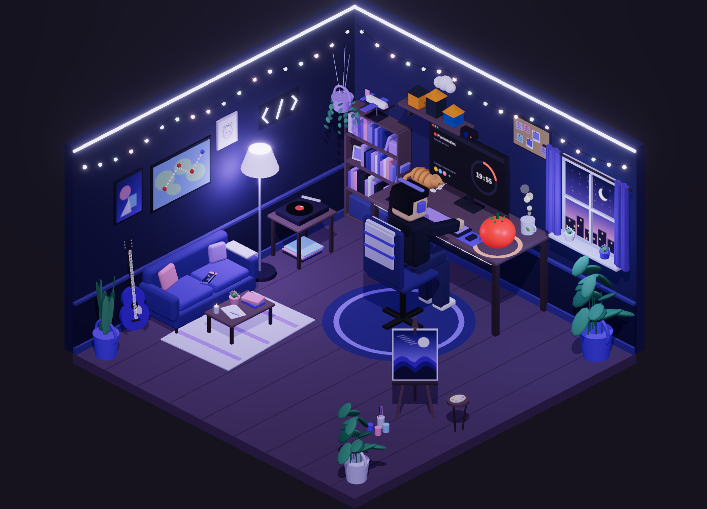

# 🌙 Cozy Room: diorama 3D do portfólio

Um quarto isométrico em 3D, feito **só com código** (React + three.js), em que cada objeto representa um projeto. Ao passar o mouse, o objeto cresce e mostra o nome do projeto. Ao clicar, a câmera vai até ele e o portfólio mostra os detalhes.

Este README serve para **reler e entender depois** como o 3D foi construído: os conceitos, onde fica cada coisa e as receitas para alterar o quarto.

---

## Sumário

1. [Como rodar](#como-rodar)
2. [As bibliotecas](#as-bibliotecas)
3. [Estrutura de pastas](#estrutura-de-pastas)
4. [Como o 3D é criado](#como-o-3d-é-criado)
5. [Animação](#animação)
6. [Interação: hover e clique](#interação-hover-e-clique)
7. [Estado: quem sabe o quê](#estado-quem-sabe-o-quê)
8. [Câmera](#câmera)
9. [Luz, cor e brilho](#luz-cor-e-brilho)
10. [Texturas desenhadas com código](#texturas-desenhadas-com-código)
11. [Formas especiais](#formas-especiais)
12. [Desempenho e acessibilidade](#desempenho-e-acessibilidade)
13. [Receitas](#receitas)
14. [Armadilhas comuns](#armadilhas-comuns)
15. [Para estudar mais](#para-estudar-mais)

---

## Projeto


---

## Como rodar

```bash
npm install
npm run dev        # abre em http://localhost:5173
```

- `?quality=low`, `medium` ou `high` na URL força um nível de qualidade (sem nada = automático)
- `npx tsc -b` confere os tipos (o Vite **não** confere sozinho)

### Usando em outro projeto

A pasta `src/diorama/` é independente: **nada dentro dela importa algo de fora**. Para usar no portfólio:

1. Copie `src/diorama/` e `public/diorama-poster.webp`
2. Instale as dependências:

```bash
npm i three @react-three/fiber @react-three/drei @react-three/postprocessing postprocessing
npm i -D @types/three
```

3. Use o componente:

```tsx
import { Diorama, type ProjectId } from './diorama'

const [selected, setSelected] = useState<ProjectId | null>(null)
const [hovered, setHovered] = useState<ProjectId | null>(null)

<Diorama
  selected={selected}
  onSelect={setSelected}
  hovered={hovered}
  onHover={setHovered}
  poster="/diorama-poster.webp" // opcional: imagem enquanto o 3D carrega
  quality="auto" // opcional: 'auto' | 'high' | 'medium' | 'low'
/>
```

> ⚠️ Requer **React 19** (o React Three Fiber 9 depende dele).

---

## As bibliotecas

| Biblioteca | O que faz | Analogia |
|---|---|---|
| **three.js** | O motor 3D de verdade: cena, câmera, luzes, formas, materiais. Desenha na GPU via WebGL. | O "motor do carro" |
| **@react-three/fiber (R3F)** | Permite escrever three.js em JSX, como componentes React | O "volante" que deixa dirigir o motor com React |
| **@react-three/drei** | Componentes prontos para o R3F (`RoundedBox`, `Html`, `Line`, `PerformanceMonitor`...) | "Acessórios" |
| **@react-three/postprocessing** | Efeitos na imagem final (bloom = brilho das luzes) | "Filtro de foto" |

### Como o R3F traduz JSX para three.js

Cada tag JSX vira um objeto do three.js:

```tsx
<mesh position={[1, 2, 3]}>                 // const mesh = new THREE.Mesh()
                                            // mesh.position.set(1, 2, 3)
  <boxGeometry args={[2, 1, 0.5]} />        // new THREE.BoxGeometry(2, 1, 0.5)  ← args = parâmetros do construtor
  <meshStandardMaterial color="#8b8cf5" />  // new THREE.MeshStandardMaterial({ color })
</mesh>
```

- O **hífen** acessa propriedades internas: `shadow-mapSize={[1024, 1024]}` vira `light.shadow.mapSize.set(1024, 1024)`.
- O R3F **libera a memória** do que foi criado em JSX. O que você cria com `new` no código é responsabilidade sua (veja [Armadilhas](#armadilhas-comuns)).

---

## Estrutura de pastas

```
src/
├─ App.tsx                    ← "imita" o portfólio: guarda o estado e usa o <Diorama>
└─ diorama/                   ← o quarto (a única pasta que vai para o portfólio)
   ├─ index.ts                ← porta de entrada: exporta só o que o portfólio pode usar
   ├─ types.ts                ← ProjectId e as props do componente (o "contrato")
   ├─ context.ts              ← estado compartilhado entre os componentes 3D
   ├─ Diorama.tsx             ← "porteiro": mostra a capa e carrega o 3D sob demanda
   ├─ DioramaScene.tsx        ← a cena de verdade: <Canvas> + tudo dentro dele
   │
   ├─ components/             ← peças reutilizáveis
   │  ├─ Box.tsx              ← caixa com sombra (e cantos arredondados com `radius`)
   │  ├─ Hotspot.tsx          ← torna qualquer objeto clicável (hover, clique, etiqueta)
   │  └─ SpeechBubble.tsx     ← balão de fala HTML preso a um ponto 3D
   │
   ├─ scene/                  ← estrutura e "bastidores"
   │  ├─ Room.tsx             ← chão, paredes, rodapés, fita de LED
   │  ├─ Desk.tsx · Chair.tsx · Monitor.tsx · Character.tsx
   │  ├─ Lights.tsx           ← luzes de ambiente
   │  ├─ CameraRig.tsx        ← controla a câmera a cada frame
   │  ├─ Effects.tsx          ← bloom + tone mapping
   │  └─ AdaptiveQuality.tsx  ← mede o FPS e ajusta a qualidade
   │
   ├─ projects/               ← os 8 objetos clicáveis (um por projeto)
   │  ├─ Tomato.tsx           ← Pomomates
   │  ├─ TravelMap.tsx        ← AI Travel Planner
   │  ├─ Webcam.tsx           ← Expression Lab
   │  ├─ Village.tsx          ← Vila Nuvem
   │  ├─ RecordPlayer.tsx     ← Mood Player
   │  ├─ Cat.tsx              ← Gatos Flutuantes
   │  ├─ CoffeeMug.tsx        ← API REST Spring Boot
   │  └─ Airplane.tsx         ← Jornada Milhas
   │
   ├─ decor/                  ← decoração (não clicável)
   │  ├─ Decor.tsx            ← O QUE vai ONDE (posiciona toda a decoração)
   │  └─ Window · FairyLights · FloorLamp · Plants · Bookshelf · Sofa · CoffeeTable
   │     · Guitar · ArtCorner · WallArt · NeonSign · Corkboard · Rugs
   │
   ├─ hooks/
   │  ├─ useInView.ts         ← o elemento está (quase) na tela?
   │  └─ usePrefersReducedMotion.ts
   │
   └─ utils/                  ← dados e funções puras (sem JSX)
      ├─ palette.ts           ← TODAS as cores do quarto
      ├─ cameraPoints.ts      ← para onde a câmera olha em cada projeto
      ├─ quality.ts           ← níveis de qualidade
      ├─ pomodoro.ts          ← relógio do pomodoro (sincroniza tomate, tela e personagem)
      ├─ drawScreen.ts        ← desenha a tela do monitor
      ├─ moods.ts · sound.ts · random.ts
```

**Regra das pastas:** `scene/` é a estrutura, `projects/` é o que é clicável, `decor/` é o enfeite e `utils/` são dados e lógica sem JSX.

---

## Como o 3D é criado

### 1. Tudo acontece dentro do `<Canvas>`

O `<Canvas>` (em `DioramaScene.tsx`) cria a cena, a câmera e o renderizador. **Componentes 3D só funcionam dentro dele.**

```tsx
<Canvas shadows orthographic camera={{ position: [10, 8.5, 10], zoom: 20 }}>
  ...luzes, objetos, efeitos...
</Canvas>
```

### 2. Coordenadas: X, Y, Z

```
        Y (cima)
        │
        │
        └──────── X (direita)
       ╱
      Z (frente, em direção a quem olha)
```

- O quarto vai de **−3.5 a 3.5** em X e Z (`ROOM_SIZE = 7`).
- **Chão:** `y = 0`. **Parede do fundo:** `z = −3.5`. **Parede da esquerda:** `x = −3.5`.
- Unidade combinada: **1 = ~50 cm**. Uma mesa com tampo em `y = 1.5` tem ~75 cm.

### 3. Mesh = geometria + material

Todo objeto visível é um **mesh**:

- **Geometria** = a forma: `boxGeometry`, `sphereGeometry`, `cylinderGeometry`, `coneGeometry`, `capsuleGeometry`, `torusGeometry`, `planeGeometry`, `circleGeometry`...
- **Material** = a aparência:
  - `meshStandardMaterial`: **reage à luz**. Use em quase tudo.
  - `meshBasicMaterial`: **ignora a luz**. Bom para telas, lâmpadas, céu, LED.

Propriedades úteis do material:

| Propriedade | O que faz |
|---|---|
| `color` | Cor base |
| `roughness` (0–1) | 0 = liso e brilhante, 1 = fosco |
| `metalness` (0–1) | Quanto parece metal |
| `emissive` / `emissiveIntensity` | "Brilho próprio", não depende da luz |
| `map` | Uma imagem (textura) sobre a superfície |
| `transparent` + `opacity` | Transparência |

### 4. ⭐ A posição é o CENTRO do objeto

O `position` aponta para o **centro** da forma, não para a base. Para algo "pisar" no chão:

```
altura = 1.45   →   position.y = 1.45 / 2 = 0.725
```

Essa é a conta mais usada no projeto inteiro.

### 5. Group: coordenadas relativas

Um `<group>` junta objetos. As posições dos filhos passam a ser **relativas ao grupo**:

```tsx
<group position={[-0.2, 0, -2.8]}>              {/* a mesa inteira fica aqui */}
  <Box position={[0, 1.5, 0]} ... />            {/* tampo: 1.5 acima do ponto do grupo */}
  <Monitor position={[-0.1, 1.55, -0.35]} />    {/* relativo à mesa */}
</group>
```

Para mover a mesa com tudo em cima, basta mudar o grupo. Grupos podem ficar um dentro do outro, e as posições vão se somando.

**Convenção do projeto:** a origem `(0, 0, 0)` de cada objeto fica na **base** (onde encosta no chão ou na mesa). Assim, o `scale` do hover cresce para cima e o objeto não afunda.

### 6. Rotação em radianos

| Radianos | Graus |
|---|---|
| `Math.PI` | 180° |
| `Math.PI / 2` | 90° |
| `Math.PI / 4` | 45° |

- `rotation={[0, Math.PI / 2, 0]}` gira em volta do eixo Y. É assim que objetos montados "de frente para +Z" passam a olhar para +X e encostam na **parede da esquerda** (veja `FACING_FROM_LEFT_WALL` em `Decor.tsx`).
- `planeGeometry`, `circleGeometry` e `ringGeometry` nascem "em pé" olhando para +Z. Para deitá-los no chão: `rotation={[-Math.PI / 2, 0, 0]}`.

### 7. Pivô: girar pelo lugar certo

A rotação acontece **em volta da origem do grupo**. Para um braço girar pelo ombro (e não pelo meio), o grupo fica **no ombro** e o braço fica pendurado para baixo dentro dele:

```
ombro ● ← origem do grupo (a rotação acontece aqui)
      │
      │  braço: centro em y = −0.38
      ▼
```

Veja `Character.tsx`: braços, cabeça e pescoço usam esse truque.

### 8. Formas em círculo (seno e cosseno)

Para espalhar N coisas em volta de um ponto (folhas do tomate, pétalas da suculenta, pés do banquinho):

```ts
const angle = (i / N) * Math.PI * 2
position = [Math.cos(angle) * raio, y, Math.sin(angle) * raio]
```

### 9. Cena guiada por dados

Quando há várias coisas parecidas (casinhas da Vila Nuvem, livros da estante, pontos da rota), descreva-as num **array** e gere com `.map()`:

```ts
const HOUSES = [
  { x: -0.55, height: 0.32, wall: AWS_ORANGE, roof: AWS_DARK },
  { x: 0, height: 0.45, wall: AWS_DARK, roof: AWS_ORANGE },
]
```

Para adicionar um item, você adiciona um dado, sem escrever JSX novo.

### 10. Sombras precisam de 3 coisas

1. `<Canvas shadows>`
2. a luz com `castShadow`
3. o mesh com `castShadow` (faz sombra) e/ou `receiveShadow` (recebe sombra)

O componente `Box` já liga as duas últimas.

---

## Animação

### O loop: `useFrame`

A cena é redesenhada ~60 vezes por segundo. O `useFrame` roda **a cada frame**, antes do desenho:

```tsx
useFrame((state, delta) => {
  state.clock.elapsedTime // segundos desde o início
  delta                   // segundos desde o frame anterior (~0.016)
})
```

### ⭐ Regra de ouro: ref para animar, state para decidir

```tsx
const ref = useRef<THREE.Group>(null!)
useFrame(() => {
  ref.current.rotation.y += 0.5 * delta   // mexe direto no objeto, SEM re-render
})
return <group ref={ref}>...</group>
```

| Muda... | Use | Exemplo |
|---|---|---|
| O tempo todo | `ref` + `useFrame` | Girar, pulsar, balançar, flutuar |
| De vez em quando | `useState` / props | Projeto selecionado, gato acordado, mood |

Usar `setState` 60 vezes por segundo faria o React recalcular tudo e a cena travaria.

### `delta`: mesma velocidade em qualquer monitor

`x += 0.01` por frame anda mais rápido num monitor de 144 Hz do que num de 60 Hz. Já `x += 1 * delta` anda **1 unidade por segundo** em qualquer tela.

### ⭐ O padrão "alvo + suavização"

Quase toda animação do projeto segue dois passos:

```ts
// 1) decide ONDE deveria estar agora
const target = isHovered ? 1.1 : 1
// 2) anda uma fração do caminho até lá
s = THREE.MathUtils.damp(s, target, velocidade, delta)
```

O resultado começa rápido e desacelera no fim, e as transições saem naturais sozinhas: se o alvo muda no meio do caminho, o objeto muda de rumo sem tranco.

| Tipo de valor | Como suavizar |
|---|---|
| Número | `THREE.MathUtils.damp(atual, alvo, velocidade, delta)` |
| Cor | `cor.lerp(corAlvo, 1 - Math.exp(-delta * velocidade))` |
| Ponto 3D | `vetor.lerp(vetorAlvo, 1 - Math.exp(-delta * velocidade))` |

### Ondas com `Math.sin` (vai e volta)

```ts
base + Math.sin(t * velocidade) * amplitude
```

| Truque | Como | Onde aparece |
|---|---|---|
| Defasagem | `Math.sin(t * 20 + 1.8)` | Braços digitando alternados |
| Pulo (só a parte positiva) | `Math.max(0, Math.sin(...))` | Alfinetes do mapa |
| Tremor irregular | Somar dois senos de velocidades diferentes | Chama da vela |
| Caminho orgânico | Velocidades diferentes em X e Y | Nuvem da Vila Nuvem |

### Loops com "fração do ciclo" (partículas)

```ts
const c = (t * velocidade + i / N) % 1     // 0 → 1, recomeça; cada item num ponto diferente
altura  = c * 0.9                          // sobe
tamanho = Math.sin(c * Math.PI)            // nasce pequeno, cresce, some
```

Aparece nas notas do toca-discos e no vapor da caneca.

### Relógio compartilhado sem estado

`utils/pomodoro.ts` é uma **função pura do tempo**. O tomate (tremer), o monitor (timer) e o personagem (se espreguiçar) chamam `getPomodoro(t)` e ficam sincronizados sem nenhum estado compartilhado.

---

## Interação: hover e clique

### Raycasting

Para saber onde o mouse está, o R3F dispara um **raio invisível** da câmera passando pelo pixel do mouse e vê quais meshes ele atravessa:

```
câmera ●──────raio──────▶ 🍅 (1º atingido) ──▶ mesa ──▶ chão
```

Com isso surgem eventos parecidos com os do DOM: `onPointerOver`, `onPointerOut`, `onClick` e, no `<Canvas>`, `onPointerMissed` (clique no vazio).

- Eventos **sobem** (bubbling): clicar na folha do tomate chega ao grupo do tomate.
- `e.stopPropagation()`: só o objeto mais **próximo** da câmera reage.
- Dica de desenvolvimento: `console.log(e.point)` num `onClick` mostra a coordenada exata do mundo onde o raio bateu. É ótimo para descobrir onde posicionar coisas.

### O componente `Hotspot`

Embrulha qualquer objeto e o torna clicável:

```tsx
<Hotspot id="pomomates" label="Pomomates" position={[1, 1.55, -2.55]} onActivate={acaoExtra}>
  ...meshes do objeto...
</Hotspot>
```

Ele cuida de:
- **hover:** cresce suavemente, cursor de mãozinha e etiqueta com o nome
- **clique:** avisa o portfólio (`onSelect`) e roda a ação extra opcional (`onActivate`), como trocar a música ou acordar o gato

A etiqueta usa o `<Html>` do drei: um `<div>` normal desenhado **por cima** do Canvas, reposicionado a cada frame para acompanhar o ponto 3D.

---

## Estado: quem sabe o quê

```
App / portfólio  ── props ──▶  <Diorama>  ──▶  Context  ──▶  qualquer componente 3D (useDiorama())
(selected, hovered)            ◀── onSelect / onHover ──
```

| Nível | Onde fica | Exemplo |
|---|---|---|
| **Externo** | Props, no portfólio | `selected`, `hovered`: o quarto **e** o painel usam |
| **Interno compartilhado** | `useState` no `DioramaScene`, distribuído pelo Context | `mood` (toca-discos muda, luminária reage), `currentQuality`, `reducedMotion` |
| **Local** | `useState` no próprio componente | `awake` do gato, `response` da caneca |

**A regra:** deixe o estado o mais perto possível de quem usa. Ele sobe até o "pai em comum" de quem precisa, e não além disso.

O `DioramaContext.Provider` fica **dentro** do `<Canvas>`, porque o Canvas tem um "renderizador" React próprio.

---

## Câmera

**Ortográfica** (`orthographic`): objetos longe **não** diminuem. É isso que dá o visual de maquete.

| | Perspectiva | Ortográfica |
|---|---|---|
| Longe | Fica menor | Fica do mesmo tamanho |
| "Zoom" | Aproximar a câmera | A propriedade `zoom` (pixels por unidade) |

### `CameraRig.tsx` (roda a cada frame)

```
posição da câmera = ponto olhado + CAMERA_OFFSET (10, 8.5, 10)
```

Imagine um drone numa haste rígida: para mostrar outro lugar, ele **desliza o alvo** sem mudar o ângulo.

1. **Alvo:** desliza até o foco do projeto selecionado (`utils/cameraPoints.ts`) ou até a visão geral (`HOME`)
2. **Inclinação:** na visão geral, o ângulo acompanha o mouse (`state.pointer`, de −1 a 1)
3. **Zoom responsivo:** `Math.min(largura / FIT_WIDTH, altura / FIT_HEIGHT) × zoom do foco`
4. `camera.updateProjectionMatrix()`: **obrigatório** depois de mudar o zoom

---

## Luz, cor e brilho

### Tipos de luz

| Luz | Comportamento | No projeto |
|---|---|---|
| `ambientLight` | Ilumina tudo por igual, sem sombra | Claridade geral |
| `hemisphereLight` | Uma cor vinda de cima e outra de baixo | "Céu" lilás + "chão" roxo |
| `directionalLight` | Raios paralelos (sol/lua), **faz as sombras** | Luz principal |
| `pointLight` | Sai de um ponto para todos os lados e enfraquece com a distância | Luminária (mood) e luz azul da janela |

### Paleta centralizada

**Todas as cores** estão em `utils/palette.ts`. Trocar o `accent` muda o quarto inteiro. É o mesmo princípio de *design tokens* em CSS.

### ⭐ Bloom: brilho só no que é mais claro que 1

O `<Bloom luminanceThreshold={1}>` (em `Effects.tsx`) faz "vazar luz" **apenas** no que tem cor acima de 1. Para algo brilhar:

```tsx
<meshBasicMaterial color={[0.55 * 2.4, 0.55 * 2.4, 0.96 * 2.4]} toneMapped={false} />
//                       ↑ RGB multiplicado → passa de 1 → brilha
```

- `toneMapped={false}`: a cor sai exatamente como você definiu, sem o "ajuste de cinema" que suaviza os tons
- Usado em: LED, pisca-pisca, neon, lâmpada da luminária, LED da webcam, chama da vela
- A tela do monitor e o céu usam `toneMapped={false}` mas ficam **abaixo** de 1, então parecem acesos sem brilhar

---

## Texturas desenhadas com código

Em vez de imagens `.png`, várias superfícies são **desenhadas com a API Canvas 2D** do navegador e viram textura:

```ts
const canvas = document.createElement('canvas')   // canvas invisível
const ctx = canvas.getContext('2d')!
ctx.fillRect(...); ctx.arc(...); ctx.fillText(...)  // desenha
const texture = new THREE.CanvasTexture(canvas)
texture.colorSpace = THREE.SRGBColorSpace           // cores fiéis
```

```tsx
<meshBasicMaterial map={texture} />
```

**Usado em:** tela do monitor (timer animado), mapa, céu da janela, pintura do cavalete, quadros e tela do console.

Pontos importantes:
- **No canvas 2D, Y cresce para baixo** (`(0, 0)` = canto superior esquerdo), ao contrário do 3D.
- **A proporção** do canvas precisa ser igual à do plano, senão a imagem estica.
- **Para atualizar:** redesenhe e marque `texture.needsUpdate = true` (o monitor faz isso só 4× por segundo, para economizar).
- `texture.magFilter = THREE.NearestFilter` deixa pixel art nítida, sem borrar.
- Crie com `useMemo` (uma vez só) e libere com `texture.dispose()` no `useEffect`.

---

## Formas especiais

| Técnica | Onde | Ideia |
|---|---|---|
| `RoundedBox` (drei) | `Box` com `radius` | Cantos arredondados, bem mais "cozy" |
| `capsuleGeometry` | Corpo do gato, fuselagem do avião | Cilindro com pontas redondas |
| Esfera com `scale` | Folhas, tomate, pufe | Esticar ou achatar uma esfera cria formas orgânicas |
| Cone com 4 lados | Telhado da Vila Nuvem | `coneGeometry args={[r, h, 4]}` vira uma pirâmide |
| Cilindro aberto | Cúpula da luminária | `openEnded = true` + `side={THREE.DoubleSide}` |
| `CatmullRomCurve3` + `TubeGeometry` | Rabo do gato | Curva **suave** por alguns pontos + um "tubo" ao longo dela |
| `CurvePath` + `LineCurve3` | Neon `</>` | Caminho de **retas** (pontas vivas) + tubo |
| `getPointAt` / `getTangentAt` | Voo do avião | Posição e direção num ponto `p` (0–1) da curva; `lookAt` aponta o nariz para a frente |
| `<Line>` (drei) | Rota do mapa, fio do pisca-pisca | Linhas com espessura e tracejado |
| Parábola `sag × 4u(1−u)` | Fio do pisca-pisca | "Barriga" do fio entre dois ganchos |
| `seededRandom` | Estante, plantas | Parece aleatório, mas é sempre igual em todo carregamento |

---

## Desempenho e acessibilidade

| Recurso | Onde | Como funciona |
|---|---|---|
| **Carregamento sob demanda** | `Diorama.tsx` | `lazy(() => import('./DioramaScene'))` coloca o 3D (~300 KB gzip) num arquivo separado, que só baixa quando a seção chega a 300px da tela. Enquanto isso, o `<Suspense>` mostra o `poster`. |
| **Pausa fora da tela** | `DioramaScene.tsx` | `IntersectionObserver` + `frameloop={visible ? 'always' : 'never'}` |
| **Qualidade adaptativa** | `AdaptiveQuality.tsx` + `utils/quality.ts` | O `PerformanceMonitor` mede o FPS: se cair, desce o nível; se sobrar, sobe (o celular fica no máximo em `medium`) |
| **Reduzir movimento** | `usePrefersReducedMotion` + `context` | Desliga inclinação da câmera, piscadas, balanços e tremores |
| **Leitor de tela** | `aria-label` no wrapper | Descreve o quarto e indica a lista de projetos para navegar pelo teclado |

| Nível | Resolução | Sombras | Bloom |
|---|---|---|---|
| `high` | até 1.5× | 2048 | ✅ |
| `medium` | 1× | 1024 | ✅ |
| `low` | 1× | ❌ | ❌ |

> **Importante:** o `index.ts` **não** exporta o `DioramaScene`. Se algo importá-lo direto, o three.js vai para o arquivo principal do site e o carregamento sob demanda deixa de funcionar.

---

## Receitas

### Mover ou adicionar decoração

Tudo é posicionado em **`decor/Decor.tsx`**. Mude o `position` e pronto.

### Mudar as cores do quarto

Edite **`utils/palette.ts`**.

### Adicionar um projeto novo (ex.: `movies`)

1. **`types.ts`:** adicione `'movies'` no `ProjectId`
2. **`utils/cameraPoints.ts`:** o TypeScript vai acusar erro até você adicionar o foco dele em `FOCUS` (é o `Record<ProjectId, Focus>` garantindo que nenhum fique de fora)
3. **`projects/MoviePoster.tsx`:** crie o objeto embrulhado no `Hotspot`:

```tsx
export function MoviePoster() {
  return (
    <Hotspot id="movies" label="Movies App" position={[x, y, z]} labelOffset={[0, 1, 0]}>
      <Box size={[0.6, 0.9, 0.03]} color={PALETTE.navy} />
      {/* ...resto do objeto, com a origem na base... */}
    </Hotspot>
  )
}
```

4. **`DioramaScene.tsx`:** adicione `<MoviePoster />`
5. **No portfólio:** adicione o projeto na lista do painel

### Descobrir onde colocar algo

Coloque temporariamente `onClick={(e) => console.log(e.point)}` no `<Box>` do chão (em `Room.tsx`) e clique no lugar desejado.

Também ajuda colocar, dentro do `<Canvas>`:

```tsx
<axesHelper args={[3]} />  {/* setas dos eixos: vermelho X, verde Y, azul Z */}
<OrbitControls />          {/* girar a câmera livremente (tire o <CameraRig /> enquanto usa) */}
```

### Fazer algo brilhar

Use `meshBasicMaterial` com `toneMapped={false}` e uma cor com algum canal **acima de 1**.

### Animar algo que fica parado

1. `const ref = useRef<THREE.Group>(null!)`
2. `<group ref={ref}>` em volta do objeto
3. No `useFrame`, decida o alvo e suavize até ele (ou use `Math.sin` para vai e volta)
4. Respeite `reducedMotion` (de `useDiorama()`) se for um movimento contínuo

---

## Armadilhas comuns

| Sintoma | Causa | Solução |
|---|---|---|
| Objeto metade enterrado | `position` é o **centro** | `y = altura / 2` |
| Superfície piscando | *Z-fighting*: duas faces no mesmo lugar | Afaste uma delas ~0.005 |
| Plano "some" de um lado | Planos só aparecem de um lado | Gire-o, ou use `side={THREE.DoubleSide}` |
| Gira "como hélice" | Origem no meio do objeto | Use um grupo como pivô |
| Zoom não muda | Faltou atualizar a projeção | `camera.updateProjectionMatrix()` |
| Textura não atualiza | A GPU não ficou sabendo | `texture.needsUpdate = true` |
| Cena travando aos pouquinhos | `new THREE.Vector3()` / `new THREE.Color()` **dentro** do `useFrame` gera lixo de memória | Crie fora (topo do arquivo ou `useMemo`) e reutilize |
| Memória da GPU crescendo | Textura/geometria/material criados com `new` não são liberados sozinhos | `useEffect(() => () => coisa.dispose(), [coisa])` |
| Vetor constante "estragando" | `.lerp()`, `.add()` etc. **alteram** o vetor | Use `.clone()` antes de guardar |
| Animação com velocidade diferente em cada PC | Valor somado por frame | Multiplique por `delta` |
| Erro "useDiorama precisa ser usado dentro do `<Diorama>`" | Componente fora do Provider | Coloque-o dentro do `<Canvas>` no `DioramaScene` |
| Tela preta | Container sem altura | O pai do `<Diorama>` precisa de altura definida |

---

## Para estudar mais

- **Documentação do R3F:** https://r3f.docs.pmnd.rs (leia *Getting started*, *Events*, *Hooks* e *Performance pitfalls*)
- **drei** (todos os componentes prontos): https://drei.docs.pmnd.rs
- **Manual do three.js:** https://threejs.org/manual (os capítulos de fundamentos)
- **Three.js Journey (Bruno Simon):** https://threejs-journey.com (pago, o curso mais completo; tem capítulo de R3F e de Blender)
- **YouTube:** Wawa Sensei (R3F prático), Wael Yasmina (three.js), SimonDev (avançado)
